<h1 align="center">ScrollPrep</h1>

<p align="center">
  <b>Make any video scroll-smooth.</b><br>
  Drop in a video, get back files that play perfectly as people scroll your site, plus the code to paste in.<br>
  Free, open source, and it runs in your browser, so your video is never uploaded anywhere.
</p>

<p align="center">
  <a href="https://scrollprep.vercel.app"><b>Try it live</b></a> &nbsp;·&nbsp;
  <a href="#examples">Examples</a> &nbsp;·&nbsp;
  <a href="#use-it-on-your-site">Use it on your site</a> &nbsp;·&nbsp;
  <a href="#how-it-works">How it works</a>
</p>

<p align="center">
  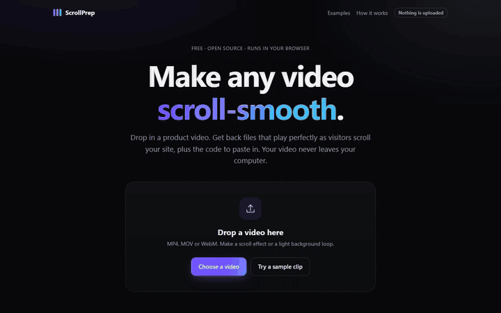
</p>

<p align="center"><a href="https://scrollprep.vercel.app"><b>→ scrollprep.vercel.app</b></a></p>

## Why this exists

Apple-style product pages play a video forward and backward as you scroll. Try that with a normal
video and it stutters, because videos only store a full picture (a *keyframe*) every few seconds.
Everything in between is just the changes, so when the scroll jumps to a random moment the browser
has to rebuild that frame from the last keyframe. It lags.

<p align="center">
  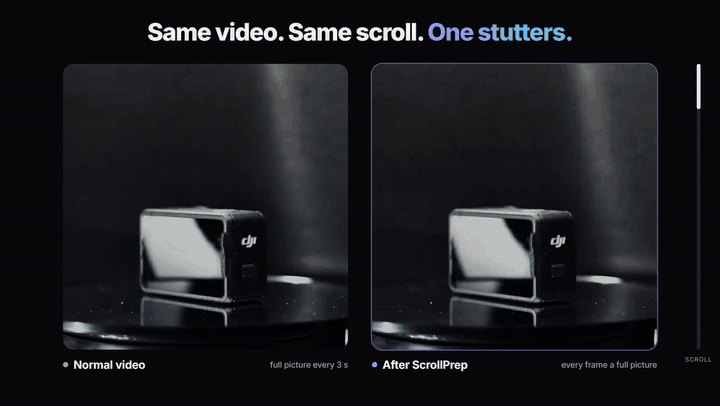
</p>

Same clip, same scroll, same player. On the left is the original, with a full picture every 3 seconds.
On the right is the ScrollPrep copy, where every frame is a full picture.

The fix is to re-save the video so every frame is a keyframe, at a sensible size, without sound, in a
format Safari accepts. That used to mean ffmpeg commands like this one:

```bash
ffmpeg -i in.mov -vf "scale=1920:1080,fps=30" -c:v libx264 -crf 20 -g 1 -pix_fmt yuv420p -movflags +faststart -an video.mp4
```

ScrollPrep does it with a drag and drop. It shows you a live preview, lets you add text and effects,
crops a separate version for phones, warns you when the files are too heavy, and hands you a zip with
the files and a tiny player.

## Examples

Six free clips from [Pexels](https://www.pexels.com), each run through ScrollPrep and dropped into a
small made-up website. The GIFs are recordings of those real pages being scrolled. You can
scroll them yourself on the [live examples page](https://scrollprep.vercel.app/examples/). The page source is
in [`public/examples`](public/examples).

<table>
  <tr>
    <td width="50%" valign="top">
      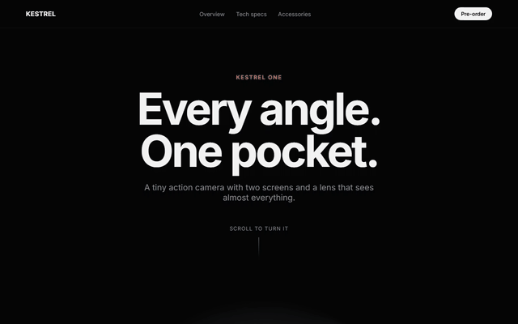
      <p><b>Product spin</b> · Full screen effect<br>
      A camera on a turntable turns as you scroll, with a line of text at each step.
      The 9 second clip had 3 keyframes. Now all 226 frames are keyframes, in 3.9 MB.</p>
      <sub><a href="https://scrollprep.vercel.app/examples/camera/">Open it live</a> · <a href="public/examples/camera/index.html">Page source</a></sub>
    </td>
    <td width="50%" valign="top">
      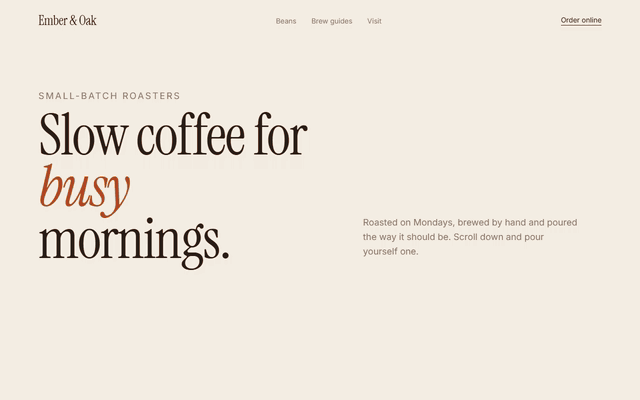
      <p><b>Coffee pour</b> · Split effect<br>
      The video sits beside a column of text that lights up line by line as the coffee pours.
      Trimmed to 8 seconds at 720p: 3.0 MB.</p>
      <sub><a href="https://scrollprep.vercel.app/examples/coffee/">Open it live</a> · <a href="public/examples/coffee/index.html">Page source</a></sub>
    </td>
  </tr>
  <tr>
    <td width="50%" valign="top">
      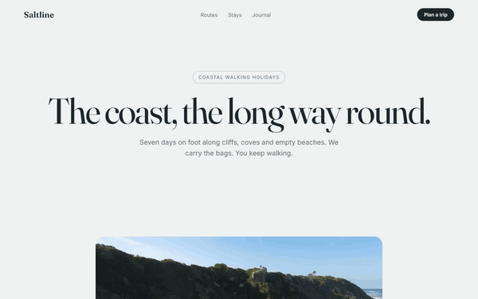
      <p><b>Coastal reveal</b> · Card grows effect<br>
      A drone shot starts as a rounded card and grows to fill the screen before the text comes in.
      A 35 MB, 35 second clip became a 7 second, 5.7 MB section.</p>
      <sub><a href="https://scrollprep.vercel.app/examples/coast/">Open it live</a> · <a href="public/examples/coast/index.html">Page source</a></sub>
    </td>
    <td width="50%" valign="top">
      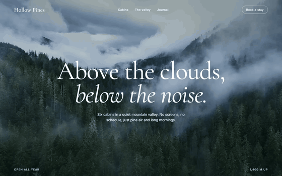
      <p><b>Background loop</b> · Header video<br>
      Not a scroll effect: a light video that autoplays behind a header. 13 MB went down to 2.4 MB,
      and the end blends into the start so you can't see where it restarts.</p>
      <sub><a href="https://scrollprep.vercel.app/examples/retreat/">Open it live</a> · <a href="public/examples/retreat/index.html">Page source</a></sub>
    </td>
  </tr>
  <tr>
    <td width="50%" valign="top">
      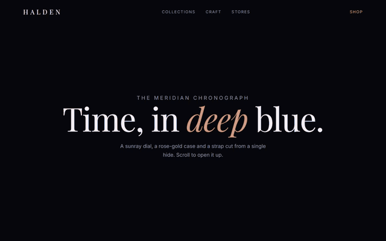
      <p><b>Watch dial</b> · Circle reveal effect, word by word text<br>
      The dial opens out of a small circle, then each line of text arrives one word at a time.
      8 seconds of a 40 second clip, 5.9 MB.</p>
      <sub><a href="https://scrollprep.vercel.app/examples/watch/">Open it live</a> · <a href="public/examples/watch/index.html">Page source</a></sub>
    </td>
    <td width="50%" valign="top">
      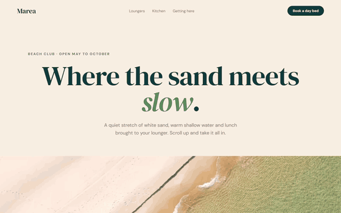
      <p><b>Beach from above</b> · Zoom out effect, blur in text<br>
      A drone looks straight down at the shoreline, turning as you scroll, and pulls back while the
      text comes into focus. 9 seconds from a 1440p clip, 7.1 MB.</p>
      <sub><a href="https://scrollprep.vercel.app/examples/beach/">Open it live</a> · <a href="public/examples/beach/index.html">Page source</a></sub>
    </td>
  </tr>
</table>

### On the ScrollPrep homepage

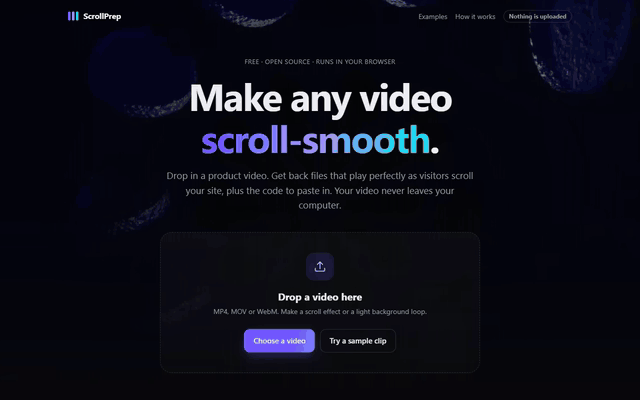

The homepage uses its own output. The dark pattern behind the header is a 10 second Pexels clip run
through **Background loop**, which shrank it from 5.4 MB to a 0.95 MB WebM (1.4 MB MP4 for Safari) with a seamless crossfade.
Under the drop zone there's a live scroll demo (Circle reveal with word by word text) so you can feel
the effect before you try your own video.

<br clear="right">

### On phones

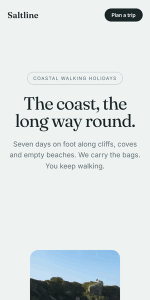

A wide video on a tall phone screen either looks tiny or loses its sides. For wide videos ScrollPrep
also makes a phone version cropped to 9:16 (or 4:5). You click the part of the video that should stay
in frame, check it in the Phone preview, and the player swaps it in on small screens along with a
matching poster.

The recording on the right is the same coastal page on a 390 px wide screen. The phone file is
606×1080 and 1.8 MB.

<br clear="right">

## What you get

| File | What it is |
|---|---|
| `scrollprep/video.mp4` | H.264, every frame a keyframe, no audio, up to 1080p. Plays everywhere. |
| `scrollprep/video-mobile.mp4` | Lighter phone copy, cropped tall for wide videos, picked automatically on small screens. |
| `scrollprep/video.webm` | Optional VP9 copy, smaller, for Chrome and Firefox. |
| `scrollprep/frames/*.webp` | Optional image sequence for a canvas player. The smoothest option on iPhones. |
| `scrollprep/poster.jpg` | First frame, shown while loading and to visitors who prefer reduced motion. |
| `scrollprep/scrollscrub.js` | A small, dependency-free player (12 KB, about 4 KB gzipped). |
| `demo.html` | A working page you can open straight away. |
| `README.txt` | Embed code and the equivalent ffmpeg commands. |

The video files work with any scroll-scrub player, such as
[scrolly-video](https://github.com/dkaoster/scrolly-video), GSAP ScrollTrigger, or the bundled
`scrollscrub.js`.

## Use it on your site

Copy the `scrollprep` folder next to your page and paste:

```html
<section class="scrollscrub" data-scrollscrub style="--scrollscrub-length:300vh">
  <div class="scrollscrub__stage">
    <div class="scrollscrub__frame">
      <video class="scrollscrub__media" muted playsinline preload="auto"
             poster="scrollprep/poster.jpg" data-src-mobile="scrollprep/video-mobile.mp4">
        <source src="scrollprep/video.mp4" type="video/mp4">
      </video>
    </div>
  </div>
</section>
<script src="scrollprep/scrollscrub.js" defer></script>
```

The section's height sets how long the effect lasts. `300vh` means three screens of scrolling.

### Effects and text

Pick an effect in the app, or set it by hand:

<p align="center">
  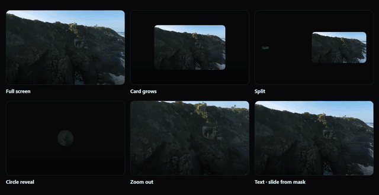
</p>

- **Full screen** (default): the video fills the screen and scrubs.
- **Card grows** (`data-layout="card"`): the video starts as a rounded card and grows to fill the
  screen over the first 40% of the scroll.
- **Split** (`data-layout="split"`): a text column beside the video on wide screens. Phones fall
  back to text over the video.
- **Circle reveal** (`data-layout="reveal"`): the video opens out of a small circle in the middle.
- **Zoom out** (`data-layout="zoom"`): the video starts zoomed in and pulls back to the full picture.

Text can come in four ways, set with `data-caption-style` on the section: fade up (the default),
`words` (one word at a time), `blur` (out of a blur) or `mask` (wiping up from behind a line).

Text appears at chosen points and stays until the next line starts. In the app you place it on a
timeline of stills from your video: drag a label (or use the arrow keys, Shift for bigger steps) and
the preview jumps to where it appears. By hand it looks like this:

```html
<div class="scrollscrub__captions">
  <div class="scrollscrub__caption" data-at="0.1">Small enough to forget.</div>
  <div class="scrollscrub__caption" data-at="0.55">Ready in a second.</div>
</div>
```

The section also gets `--scrollscrub-progress` and `--scrollscrub-grow` CSS variables (0 to 1), so
you can drive your own styles from the scroll. Visitors who turn on reduced motion get the poster with
all the text listed underneath.

### Background loops

Pick **Background loop** instead of Scroll effect to shrink a video for autoplay behind a page
header. It keeps normal keyframes (every 2 seconds), strips the sound, caps the size and can
crossfade the end into the start so the restart is invisible. You get an MP4, an optional WebM, a
poster, the HTML and CSS, and a small script that shows the still poster to visitors who prefer
reduced motion.

## How it works

<p align="center">
  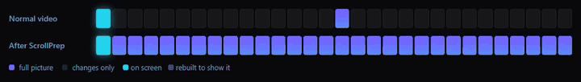
</p>

Each square is a frame. Blue squares are full pictures. When the scroll lands on a frame (cyan), a
normal video has to rebuild it from the last full picture, so every frame in between lights up too.
After ScrollPrep every frame is a full picture, so the browser just shows the one you're on.

- **Video engine:** [WebCodecs](https://developer.mozilla.org/docs/Web/API/WebCodecs_API), the
  browser's built-in and usually hardware-accelerated encoder, through
  [Mediabunny](https://mediabunny.dev). No 30 MB ffmpeg download and no special server headers, so
  the site stays a small static page.
- **Preview:** the preview is the exact demo page from the zip, rendered in an iframe with the files
  swapped for in-memory URLs. What you see is what you ship.
- **Browser support:** current Chrome, Edge and Safari, and desktop Firefox. If a browser can't read
  or encode a file, ScrollPrep says so and shows the ffmpeg commands to run instead. So far it has
  been tested most in Chrome.

## Development

```bash
npm install
npm run dev
```

```bash
npm test
```

```bash
npm run e2e
```

The end-to-end run builds the app, drives headless Chrome through real conversions (a sample, a 4K
clip with sound, a trimmed portrait clip, background loops and a broken file), downloads each zip and
checks with ffprobe that every frame is a keyframe, sizes are capped and audio is gone. It needs
Chrome or Edge plus ffmpeg and ffprobe on your PATH.

The examples and GIFs are made by two scripts, so they can be rebuilt after a change:

```bash
node scripts/showcase.mjs
```

```bash
node scripts/record.mjs
```

The first downloads the Pexels clips and runs each one through the app (including the homepage's
header loop, which lands in `public/hero`). The second scrolls each example page in headless Chrome,
takes a screenshot per step and turns them into the GIFs in `docs/media`. The before/after GIF comes
from the comparison that `scripts/launch-clip.mjs` records.

Code layout:

- `src/core`: pure logic (sizes, bitrates, size budgets, crops, snippet and ffmpeg generation), unit tested
- `src/engine`: media work in the browser (probe, encode, frames, loops, pipeline, zip)
- `src/runtime/scrollscrub.js`: the player that ships in every zip
- `src/main.ts`, `src/ui`, `src/styles.css`, `index.html`: the interface
- `public/examples`: the example sites

## Deploying

It is a static site. On Vercel, import the repo and keep the defaults (framework: Vite, output:
`dist`). Any static host works the same way.

## Credits

Example footage from Pexels, free to use under the [Pexels license](https://www.pexels.com/license/):

- Camera: [Pho Tomass](https://www.pexels.com/@pho-tomass-883344227)
- Coffee: [Joshua Woroniecki](https://www.pexels.com/@joshuaworoniecki)
- Coast: [Luz Calor Som](https://www.pexels.com/@luz-calor-som-99374650)
- Mountains: [Alex Moliski](https://www.pexels.com/@alexmoliski)
- Watch: [Jourean van Beek](https://www.pexels.com/@jourean-van-beek-2152972005)
- Beach: [sayari bechir](https://www.pexels.com/@bechir)
- Homepage background: [Nicola Narracci](https://www.pexels.com/@nicola-narracci-157460431)

The brands in the examples (Kestrel, Ember & Oak, Saltline, Hollow Pines, Halden, Marea) are made up.

## License

MIT
